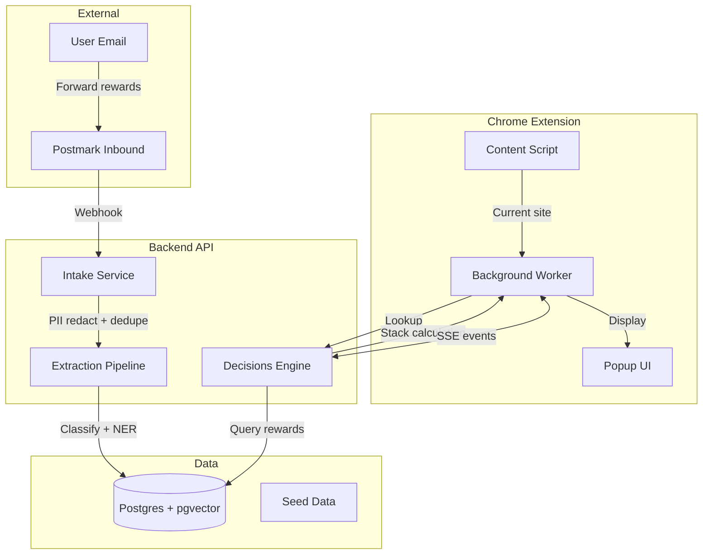

# PerkSense

**Find and stack your store rewards, card cashback, and memberships at checkout.**

A Chrome extension + backend that automatically surfaces applicable rewards when you shop, then calculates the optimal way to stack them for maximum savings.

> 🏆 DubHacks 2026 - Visa "Reimagine Shopping" Track

## Architecture



## Tech Stack

| Layer | Technology |
|-------|------------|
| Frontend | WXT + React + TypeScript (Chrome MV3 Extension) |
| Backend | Python 3.11 + FastAPI + Pydantic v2 |
| Database | Postgres + pgvector (384-dim MiniLM embeddings) |
| ML | SetFit (classification), GLiNER2 (NER), Presidio (PII) |
| Optimization | OR-Tools CP-SAT (reward stacking) |

## Repository Layout

```
├── backend/
│   ├── app/
│   │   ├── main.py          # FastAPI app with stub endpoints
│   │   └── schemas.py       # Pydantic v2 models (SOURCE OF TRUTH)
│   ├── intake/              # Person 1: Email ingestion
│   ├── extraction/          # Person 2: NER + classification
│   ├── decisions/           # Person 3: Stacking + lookup + sync
│   └── tests/
├── frontend/                # Person 4: Chrome extension
├── shared/
│   ├── schemas/             # JSON Schema files (generated)
│   ├── seed/                # Demo data + test emails
│   │   ├── seed_rewards.json
│   │   ├── seed_cards.json
│   │   ├── seed_merchants.json
│   │   ├── seed_memberships.json
│   │   ├── emails/          # Sample .eml files
│   │   └── fixtures/        # Test scenarios
│   ├── types.ts             # TypeScript types (generated)
│   ├── openapi.json         # OpenAPI 3.1 spec (generated)
│   └── CONTRACTS.md         # API contract documentation
├── scripts/
│   └── gen_contracts.py     # Regenerate schemas + types
├── docs/
│   └── schema.sql           # Postgres DDL
├── requirements.txt         # Core Python deps
└── requirements-ml.txt      # ML deps (heavy, optional for stubs)
```

## Quick Start

### 1. Install Dependencies

```bash
# Core deps (fast, for stub development)
pip install -r requirements.txt

# ML deps (heavy, only when implementing real features)
pip install -r requirements-ml.txt
```

### 2. Run the API Server

```bash
uvicorn backend.app.main:app --reload --port 8000
```

- API docs: http://localhost:8000/docs
- OpenAPI spec: http://localhost:8000/openapi.json

### 3. Run Tests

```bash
pytest backend/tests/ -v
```

## Team Ownership

| Person | Area | Directory | Key Files |
|--------|------|-----------|-----------|
| 1 | Intake | `backend/intake/` | Postmark webhook, Presidio, dedupe, `/demo/inject` |
| 2 | Extraction | `backend/extraction/` | SetFit, JSON-LD, GLiNER2, `/classify-merchant` |
| 3 | Decisions | `backend/decisions/` | Postgres, CP-SAT stacking, lookup, SSE |
| 4 | Frontend | `frontend/` | Chrome extension, UI, types integration |

## Golden Rules

### Contract Changes

**Never modify contracts without coordinating:**

1. Edit `backend/app/schemas.py`
2. Run `python scripts/gen_contracts.py`
3. Commit together: `shared/schemas/`, `shared/types.ts`, `shared/openapi.json`
4. Notify the team in Slack

### Integration Points

- **Backend devs**: Implement your module, import from `backend.app.schemas`
- **Frontend dev**: Import types from `shared/types.ts`, call endpoints per `shared/CONTRACTS.md`
- **All**: Use seed data for development, real data only in production

### Auth (Hackathon Simplification)

- Pass `X-User-Id` header with user's UUID
- Demo user: `00000000-0000-0000-0000-000000000001`
- No real auth implemented - add OAuth later

### CORS

- Configured for `chrome-extension://*` origins
- Also allows `localhost` for development

## API Endpoints

| Endpoint | Method | Owner | Purpose |
|----------|--------|-------|---------|
| `/health` | GET | All | Health check |
| `/inbound` | POST | Person 1 | Postmark webhook |
| `/demo/inject` | POST | Person 1 | Replay test emails |
| `/classify-merchant` | POST | Person 2 | Classify unknown merchants |
| `/wallet` | GET/POST | Person 3 | Get/update user wallet |
| `/stack` | POST | Person 3 | Calculate optimal stacking |
| `/lookup` | POST | Person 3 | Find relevant rewards |
| `/sync` | GET | Person 3 | Polling sync endpoint |
| `/events` | GET | Person 3 | SSE real-time updates |

See `shared/CONTRACTS.md` for full request/response documentation.

## Seed Data

Demo data is pre-loaded for immediate frontend integration:

- **25 rewards** across 10+ merchants (Hollister, Target, Nike, Starbucks, etc.)
- **5 Visa cards** with category cashback (demo cards, not real)
- **5 memberships** (Costco Executive, Target Circle, Sephora VIB, etc.)
- **50 merchants** with MCC codes and categories
- **5 sample emails** for intake testing

## Key Algorithms

### Stacking Engine (CP-SAT)

```
maximize: sum(savings_i * x_i) + card_cashback
subject to:
  - x_a + x_b <= 1 for non-combinable pairs
  - sum(min_spend_i * x_i) <= cart_total
  - sum(is_promo_code_i * x_i) <= 1
  - x_i ∈ {0, 1}
```

### Lookup Ranking

```
score = value_usd × match × (1 + exp(-days_left/3))
```

Returns top 3 rewards by score.

## License

MIT License - DubHacks 2026
